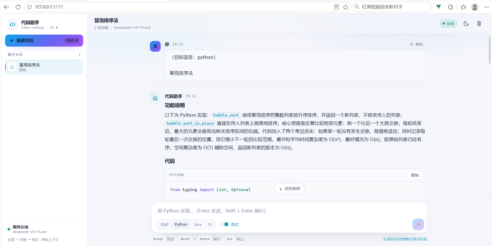
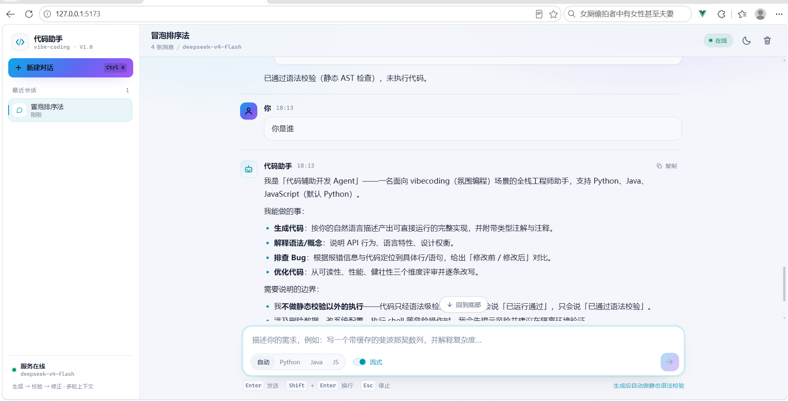

# 代码辅助开发 Agent

> 面向 **vibecoding** 的多语言代码助手：用自然语言描述意图，交付「可运行、可解释、可落地」的代码。
> 基于 **LangChain 1.x `create_agent` + LangGraph**，落地 **生成 → 校验 → 修正** 闭环，提供 **CLI** 与 **REST/SSE API** 两种形态。

| 项目 | 内容 |
| --- | --- |
| 版本 | v1.0.0 |
| 支持语言 | Python / Java / JavaScript（未指定时默认 Python） |
| 模型 | `deepseek-v4-flash` / `deepseek-v4-pro`（OpenAI 兼容地址可切换） |
| 形态 | CLI 交互 + FastAPI（`/chat`、`/chat/stream`） |
| 依赖 | 见 `requirements.txt`（`python-dotenv` / `pydantic-settings` / `langsmith`） |

---

## 界面预览

| 代码生成 + 语法校验（暗色） | 多轮上下文对话（亮色） |
| --- | --- |
|  |  |

> 前端为 Vue 3 独立工程，见 [frontend/README.md](frontend/README.md)。

---


## 1. 功能特性

| 能力 | 实现方式 | PRD 对应 |
| --- | --- | --- |
| 多语言代码生成 | Prompt 契约（命名/类型注解/异常/注释规范）+ 结构化输出模板 | 5.1 |
| 语法解释 | 「是什么 → 为什么 → 怎么用 → 注意事项」四要素模板 | 5.2 |
| Bug 排查 | 行号级错误定位 + 修改前后对比 + 校验工具验证 | 5.3 |
| 代码优化 | `review_code` 工具从可读性/性能/健壮性输出「为什么改、改了什么」 | 5.4 |
| 多轮记忆 | LangGraph `messages` State + `InMemorySaver` + `thread_id` | 5.5 |
| 长对话防溢出 | `SummarizationMiddleware`（token 触发 + 保留最近 N 条） | 5.5 |
| 代码静态校验 | `validate_code`：Python 用 `ast.parse`；JS/Java 用词法规则 | 5.6 |
| 修正闭环 | 校验失败 → 带错误信息回灌模型 → 重试（上限可配） | 5.6 |
| 反幻觉 | Prompt 约束 + 校验兜底 + 强制「功能说明/代码/关键点/运行说明」四段式 | 5.7 |
| 安全 | 不执行任何代码，仅静态分析；双层限流（并发信号量 + 模型调用配额） | 4.2 / 9 |
| Web 界面 | Vue 3 + Vite 前端：流式打字机、代码高亮、校验可视化、多会话管理 | 4.1 |
| 可观测 | 全链路 LangSmith 追踪（`run_name` / `tags` / `metadata`） | 9 |

---

## 2. 目录结构

```
code-assistant-agent/
├── app/
│   ├── __init__.py        # 版本信息
│   ├── config.py          # pydantic-settings 配置 + LangSmith 环境同步
│   ├── prompts.py         # 代码规范 / 输出契约 / 反幻觉 Prompt
│   ├── schemas.py         # 请求响应模型（ChatRequest / ChatResponse / ...）
│   ├── validator.py       # 静态校验引擎（Python ast + JS/Java 规则）
│   ├── reviewer.py        # 代码质量评审（可读性/性能/健壮性）
│   ├── tools.py           # @tool：validate_code / review_code
│   ├── agent.py           # create_agent 构建、流式事件、记忆管理
│   └── main.py            # FastAPI 入口（/chat、/chat/stream、/health、会话管理）
├── tests/                 # unittest 测试（89 个用例，不联网）
├── frontend/              # Vue 3 + Vite 前端（前后端分离，见第 5 节）
│   ├── src/               # 组件 / composables / API 客户端（SSE）
│   ├── nginx.conf         # 生产反代（含 SSE 不缓冲）
│   └── Dockerfile         # 多阶段构建：node → nginx
├── cli.py                 # 命令行交互客户端
├── requirements.txt       # 课程统一依赖（含项目 B，可忽略）
├── requirements-app.txt   # 本项目最小运行依赖（Docker 使用）
├── .env / .env.example    # 环境变量
├── Dockerfile / docker-compose.yml
└── PRD-代码辅助开发Agent.md
```

---

## 3. 快速开始

### 3.1 环境准备

依赖已安装在本项目 `.venv` 中（Python 3.11+，实测 3.14）：

```powershell
# Windows PowerShell
.\.venv\Scripts\Activate.ps1
# 或直接用解释器： .\.venv\Scripts\python.exe cli.py

# 如从零安装：
pip install -r requirements.txt
```

### 3.2 配置

```powershell
copy .env.example .env      # 已提供 .env，可直接编辑
```

编辑 `.env`，至少填写：

```dotenv
DEEPSEEK_API_KEY=sk-xxxxxxxxxxxxxxxx
DEEPSEEK_BASE_URL=https://api.deepseek.com/v1
DEEPSEEK_MODEL=deepseek-v4-flash
```

检查配置是否生效：

```powershell
.\.venv\Scripts\python.exe cli.py --check
```

> 未配置 Key 时服务仍可启动：`/health` 返回 `degraded`，`/chat` 返回 503 并给出提示，方便先跑通部署链路。

### 3.3 CLI 交互

```powershell
# 交互模式（默认流式输出）
.\.venv\Scripts\python.exe cli.py

# 单次提问
.\.venv\Scripts\python.exe cli.py -m "写一个 Python 函数，递归求斐波那契，带缓存优化"

# 指定语言与会话（同 thread_id 共享多轮上下文）
.\.venv\Scripts\python.exe cli.py --language java --thread-id demo-01

# 关闭流式
.\.venv\Scripts\python.exe cli.py --no-stream
```

交互内命令：

| 命令 | 说明 |
| --- | --- |
| `/help` | 帮助 |
| `/new` | 新会话（新 thread_id） |
| `/thread <id>` | 切换会话 |
| `/lang python\|java\|javascript\|auto` | 设置目标语言 |
| `/history` | 查看当前会话历史 |
| `/stream on\|off` | 切换流式/普通输出 |
| `/check` | 查看配置状态 |
| `/exit` | 退出 |

### 3.4 启动 API 服务

```powershell
# 方式一
.\.venv\Scripts\python.exe -m app.main

# 方式二（开发热重载）
.\.venv\Scripts\python.exe -m uvicorn app.main:app --reload --port 8000
```

打开 <http://127.0.0.1:8000/docs> 查看交互式接口文档。

---

## 4. API 说明

### 4.1 健康检查

```http
GET /health
```

```json
{
  "status": "ok",
  "version": "1.0.0",
  "model": "deepseek-v4-flash",
  "api_key_configured": true,
  "memory_backend": "InMemorySaver",
  "tracing": false,
  "supported_languages": ["python", "java", "javascript"],
  "timestamp": "2026-11-05T17:40:00"
}
```

### 4.2 普通对话

```http
POST /chat
Content-Type: application/json

{ "thread_id": "u-001", "message": "写一个 Python 二分查找，带注释", "language": "python" }
```

```json
{
  "thread_id": "u-001",
  "answer": "### 功能说明 ...\n### 代码\n```python ...\n### 关键点 ...\n### 运行说明 ...",
  "language": "python",
  "validation": { "valid": true, "errors": [], "suggestion": "语法校验通过", "language": "python" },
  "usage": { "elapsed_ms": 5321 }
}
```

`language` 可省略或传 `auto`，由 Agent 自判（缺省 Python）；`thread_id` 省略时为 `default`。

### 4.3 流式对话（SSE）

```http
POST /chat/stream
Content-Type: application/json

{ "thread_id": "u-002", "message": "把上面的函数改成异步版本" }
```

```powershell
curl.exe -N -X POST http://127.0.0.1:8000/chat/stream ^
  -H "Content-Type: application/json" ^
  -d "{\"thread_id\":\"u-002\",\"message\":\"写一个 JavaScript 防抖函数\"}"
```

响应为 `text/event-stream`，事件类型：

| event | data 示例 | 说明 |
| --- | --- | --- |
| `meta` | `{"thread_id":"u-002","model":"deepseek-v4-flash"}` | 流开始 |
| `token` | `{"content":"### 功"}` | 增量 token（打字机效果） |
| `tool_call` | `{"name":"validate_code","args":{...}}` | 模型发起校验 |
| `tool_result` | `{"name":"validate_code","valid":false,"content":"..."}` | 校验结果 |
| `done` | `{"answer":"完整回答","validation":{...},"usage":{"elapsed_ms":6210}}` | 结束（含完整答案） |
| `error` | `{"detail":"模型调用失败：..."}` | 异常（流内不中断 HTTP 状态） |

### 4.4 会话管理

```http
GET    /threads/{thread_id}/history   # 读取历史消息
DELETE /threads/{thread_id}           # 清空会话（删除 checkpoint）
```

### 4.5 错误码

| 状态码 | 场景 | 处理建议 |
| --- | --- | --- |
| 422 | 请求体校验失败（message 为空、thread_id 含非法字符） | 修正请求体 |
| 413 | message 超过 `MAX_MESSAGE_CHARS` | 拆分问题 |
| 503 | 未配置 `DEEPSEEK_API_KEY` | 配置 `.env` 后重启 |
| 502 | 模型/上游调用失败 | 查看服务端日志 |
| 504 | 调用超时 | 调大 `REQUEST_TIMEOUT` |

---

## 5. 前端（Vue 3 + Vite）

前后端分离：`frontend/` 是独立工程，通过 `/api` 前缀访问后端 —— 开发期由 Vite 代理，生产期由 Nginx 反代，前后端可分别部署、独立扩容。

### 5.1 启动

```powershell
# 终端 1：后端（http://127.0.0.1:8000）
.\.venv\Scripts\python.exe -m app.main

# 终端 2：前端（http://127.0.0.1:5173）
cd frontend
npm install        # 首次
npm run dev
```

打开 <http://127.0.0.1:5173> 即可对话；前端会轮询 `/health`，未配置 Key 或后端未启动时给出明确提示。

### 5.2 能力

| 能力 | 实现 |
| --- | --- |
| 流式打字机 | `fetch` + ReadableStream 手写 SSE 解析（`EventSource` 不支持 POST），支持随时停止 |
| Markdown + 代码 | `markdown-it`（关闭原始 HTML 防 XSS）+ `highlight.js` 按需注册语言 + 代码块一键复制 |
| 校验可视化 | 工具调用状态条（校验中 / 通过 / 未通过）+ 校验卡片（行号、原因、修复建议、质量提示，失败默认展开） |
| 多会话 | 会话索引存 localStorage；切换时拉取后端 `GET /threads/{id}/history`；删除同步后端 |
| 断线兜底 | 后端重启导致历史为空时回退到本地缓存 |
| 语言 / 模式 | 自动 / Python / Java / JS；流式与非流式切换；偏好持久化 |
| 体验 | 暗色 / 亮色主题、移动端抽屉侧栏、`Ctrl/⌘+K` 新建会话、`Esc` 停止生成、自动滚动 + 回到底部 |

### 5.3 构建与部署

```powershell
cd frontend
npm run build          # 产物 dist/，默认请求 /api
npm run preview        # 本地预览构建产物

# 或使用 Docker（Nginx 静态托管 + /api 反代，含 SSE 不缓冲）
docker compose up --build -d   # 前端 http://127.0.0.1:8080，后端 8000
```

若前端与后端不同源且没有反向代理，构建前设置 `VITE_API_BASE=https://api.example.com`（见 `frontend/.env.example`）。

> 详细说明见 [frontend/README.md](frontend/README.md)。

---

## 6. 核心实现说明

### 6.1 校验闭环（PRD 5.6 / 6）

```
用户输入 → Agent 生成代码
              │
              ▼
       validate_code（@tool，静态分析）
              │
      valid? ─否→ 错误行号/原因回灌模型 → 修正 → 重新校验（最多 N 次）
              │是
              ▼
       输出：功能说明 + 代码 + 关键点 + 运行说明
```

- 工具返回 `{"valid", "errors", "suggestion"}`（PRD 约定），另附 `language` / `warnings` / `checker` 便于观测；
- 采用 `response_format="content_and_artifact"`：模型看到紧凑文本（省 token），API 层拿到结构化 artifact（前端可高亮行号）；
- `ToolCallLimitMiddleware` 限制校验工具调用次数、`ModelCallLimitMiddleware` 限制模型调用次数，避免「校验-修正」死循环；
- 达到上限后模型必须如实告知问题，禁止声称「已通过」。

**校验规则**

| 语言 | 检查器 | 能发现的问题 |
| --- | --- | --- |
| Python | `ast.parse` | 全部语法错误（缺失冒号、缩进、括号、全角标点…）；另给裸 `except`、`== None`、可变默认参数、`eval/exec` 质量提示 |
| JavaScript | 词法扫描 + 规则 | 括号/引号/块注释未闭合、`function` 形式错误、声明缺变量名、赋值缺表达式；`var` / `==` 质量提示 |
| Java | 词法扫描 + 规则 | 括号/引号未闭合、缺类声明、`import`/`return`/调用语句缺分号、空 `catch` 等 |

规则实现先用一遍扫描把字符串与注释「抹白」为占位符（保留字符位置），再做括号配对与行级规则匹配 —— 因此字符串里的 `{`、`//` 不会误报，行号列号仍然精准。

### 6.2 多轮记忆（PRD 5.5）

- `create_agent(..., checkpointer=InMemorySaver())`，同一 `thread_id` 自动累积 `messages`；
- 长对话由 `SummarizationMiddleware` 在超过 `SUMMARIZATION_TRIGGER_TOKENS` 时压缩历史，保留最近 `SUMMARIZATION_KEEP_MESSAGES` 条；
- 生产可替换为 `langgraph-checkpoint-postgres` 的 `PostgresSaver`（只需替换 `CodeAssistant` 的 `checkpointer`）。

### 6.3 中间件栈（PRD 7 / 9）

| 中间件 | 作用 |
| --- | --- |
| `SummarizationMiddleware` | 长对话摘要，防上下文溢出 |
| `ModelCallLimitMiddleware` | 单次请求模型调用配额（默认 12），防死循环 / 天然限流 |
| `ToolCallLimitMiddleware` | `validate_code` 调用配额（默认 8） |
| `ModelRetryMiddleware` | 网络抖动自动重试（最多 2 次） |

### 6.4 反幻觉（PRD 5.7）

1. Prompt 强制四段式输出，代码与说明分离；
2. 所有代码必须经过 `validate_code`，回答中的代码与校验版本一致；
3. 禁止声称「已运行通过」，只能表述为「已通过语法校验」；
4. 不确定的 API / 版本必须标注「可能因版本而异」；
5. 校验失败次数用尽时如实说明未解决点。

### 6.5 可观测（PRD 9）

- `config["run_name"] = "code-assistant/chat|stream"`、`tags=["code-assistant-agent", "thread:<id>"]`、`metadata` 带模型与会话；
- 设置 `LANGSMITH_TRACING=true` + `LANGSMITH_API_KEY` 后，LangSmith 可见完整链路（模型调用、工具调用、中间件节点）。

---

## 7. 测试

```powershell
# 全量（89 个用例，全部使用假模型，无需 API Key、不联网）
.\.venv\Scripts\python.exe -m unittest discover -s tests -t . -v

# 单模块
.\.venv\Scripts\python.exe -m unittest tests.test_validator -v
.\.venv\Scripts\python.exe -m unittest tests.test_agent -v
.\.venv\Scripts\python.exe -m unittest tests.test_api -v
```

| 测试文件 | 覆盖内容 |
| --- | --- |
| `tests/test_validator.py` | 三语言合法/非法样例、错误行号、全角标点、代码围栏、语言识别 |
| `tests/test_prompts_reviewer.py` | Prompt 契约（四段式/反幻觉/重试次数注入）、评审三维度 |
| `tests/test_tools.py` | `@tool` content/artifact 双通道、`{valid, errors, suggestion}` 结构 |
| `tests/test_agent.py` | 生成→校验失败→修正→通过闭环、多轮记忆、会话隔离、流式事件、调用配额兜底 |
| `tests/test_api.py` | 路由、422/413/502/503 映射、SSE 事件序列、历史与删除 |
| `tests/test_cli.py` | CLI 参数解析、状态渲染、流式/普通输出的问答流程 |
| `tests/test_config.py` | Settings 校验、模型工厂、LangSmith 环境变量同步 |

---

## 8. 验收对照（PRD 第 12 节）

| 验收项 | 本项目落地 | 验证方式 |
| --- | --- | --- |
| 1. 三语言代码生成准确率 ≥ 90% | 三语言规范 Prompt + 强制静态校验 + 修正重试 | `tests/test_agent.py::test_generate_validate_fix_loop`、`tests/test_validator.py` |
| 2. 语法校验通过率 100%（可解析语言） | Python `ast.parse`；JS/Java 规则校验（限静态可判定部分） | `tests/test_validator.py` |
| 3. 连续三轮上下文命中 ≥ 85% | `thread_id` + checkpointer + Prompt 指代规则 | `tests/test_agent.py::test_multi_turn_context_is_reused` |
| 4. `/chat` 与 `/chat/stream` 可调用且流式稳定 | FastAPI + `sse-starlette`，含 meta/token/tool/done 事件 | `tests/test_api.py::StreamEndpointTests` |
| 5. 代码附带注释与运行说明 | Prompt 四段式契约 + 工具链兜底 | `tests/test_prompts_reviewer.py::PromptContractTests` |
| 6. LangSmith 可见完整链路 | `run_name`/`tags`/`metadata` + 环境变量同步 | 配置 `LANGSMITH_TRACING=true` 后查看后台 |

---

## 9. Docker 部署（M4 交付物）

```powershell
# 一键起后端 + 前端（前端 8080，后端 8000）
docker compose up --build -d

# 或单独构建
docker build -t code-assistant-agent:1.0.0 .                    # 后端（最小依赖集）
docker build -t code-assistant-frontend:1.0.0 ./frontend        # 前端（Nginx）
```

| 服务 | 镜像 | 端口 | 说明 |
| --- | --- | --- | --- |
| 后端 | `code-assistant-agent:1.0.0` | 8000 | `requirements-app.txt` 最小依赖；非 root 运行；内置 `HEALTHCHECK` |
| 前端 | `code-assistant-frontend:1.0.0` | 8080 | 多阶段构建（node → nginx）；`/api` 反代到后端，SSE 关闭缓冲 |

> compose 中前端依赖后端健康检查通过后再启动，避免首屏健康检查失败。

---

## 10. 常见问题

**Q：`/health` 返回 `degraded`？**
A：未读取到 `DEEPSEEK_API_KEY`。确认 `.env` 在项目根目录且已填写，重启服务。

**Q：模型调用超时 / 502？**
A：检查网络与 `DEEPSEEK_BASE_URL`；内网环境可调大 `REQUEST_TIMEOUT`，或把 `DEEPSEEK_MODEL` 换成更快的小模型。

**Q：JS/Java 校验会不会误报？**
A：规则校验只覆盖「括号/引号/注释/分号/关键字」这类静态可判定错误，不对类型系统、泛型、第三方 API 做判断。若需 100% 语法级校验，可在运行环境安装 `node --check` / `javac` 后作为外部校验接入（PRD 4.2 明确不做代码执行，故未内置）。

**Q：如何换成 PostgreSQL 记忆？**
A：`requirements.txt` 中已注释 `langgraph-checkpoint-postgres`；安装后把 `CodeAssistant(checkpointer=PostgresSaver(...))` 注入即可，接口层无需改动。

**Q：如何新增语言（如 Go）？**
A：在 `app/validator.py` 增加 `_validate_go` 与检测权重，在 `SUPPORTED_LANGUAGES` 注册；`app/prompts.py` 与 `app/schemas.py` 的语言枚举同步即可。
