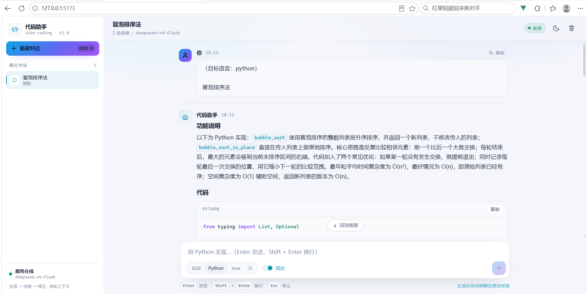
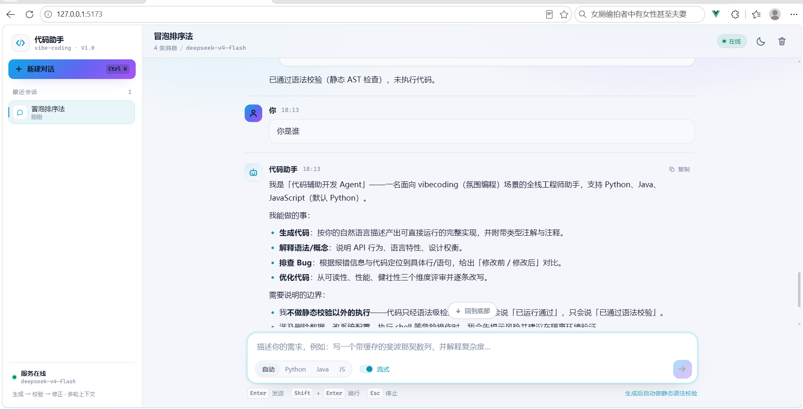

# 代码助手前端 · Vue 3 + Vite

后端「代码辅助开发 Agent」的 Web 前端，前后端分离部署。





## 特性

| 能力 | 说明 |
| --- | --- |
| 流式对话 | `fetch` + ReadableStream 手写 SSE 解析（`EventSource` 不支持 POST），逐 token 渲染、可随时停止 |
| Markdown 渲染 | `markdown-it`（禁用原始 HTML）+ `highlight.js` 按需注册语言 + 代码块复制 |
| 校验可视化 | 工具调用状态条（校验中 / 通过 / 未通过）+ 校验卡片（行号、原因、修复建议、质量提示） |
| 多会话 | 会话列表本地持久化，切换时从后端 `GET /threads/{id}/history` 拉取历史；删除同步后端 |
| 断线兜底 | 后端重启导致历史为空时，自动回退到本地消息缓存 |
| 语言与模式 | 自动 / Python / Java / JS 目标语言；流式与非流式切换；偏好持久化 |
| 健康检查 | 每 30s 轮询 `/health`，区分「服务未连接」「未配置 API Key」「在线」 |
| 体验 | 暗色/亮色主题、响应式（移动端抽屉侧栏）、`Ctrl/⌘+K` 新建会话、`Esc` 停止生成、自动滚动 |

## 目录结构

```
frontend/
├── index.html                 # 首屏主题预置（避免闪烁）
├── vite.config.js             # /api 代理 + 构建配置
├── src/
│   ├── App.vue                # 布局与编排
│   ├── style.css              # 设计 token / Markdown / 代码高亮样式
│   ├── api/client.js          # REST + SSE 客户端与错误映射
│   ├── composables/
│   │   ├── useChat.js         # 消息状态机（流式事件 → UI 状态）
│   │   ├── useThreads.js      # 会话索引（localStorage）
│   │   ├── useHealth.js       # 健康检查轮询
│   │   └── useTheme.js        # 主题切换
│   ├── components/            # 侧边栏 / 头部 / 消息 / 代码 / 校验 / 输入 / 欢迎页
│   └── utils/                 # Markdown 渲染、格式化、剪贴板
├── nginx.conf                 # 生产反代（含 SSE 不缓冲）
└── Dockerfile                 # 多阶段构建：node → nginx
```

## 开发运行

```bash
# 1) 先启动后端（项目根目录）
.venv\Scripts\python.exe -m app.main          # http://127.0.0.1:8000

# 2) 前端
cd frontend
npm install                                   # 首次
npm run dev                                   # http://127.0.0.1:5173
```

开发时 `/api/*` 由 Vite 代理到 `VITE_PROXY_TARGET`（默认 `http://127.0.0.1:8000`），因此不存在跨域问题。
如需直连其它后端，复制 `.env.example` 为 `.env.local` 并修改。

## 生产构建

```bash
npm run build          # 产物在 dist/
npm run preview        # 本地预览构建产物（默认 4173）
```

产物默认请求 `/api`，由 Nginx 反代（见 `nginx.conf`）；若前后端不同源且没有反代，
构建前设置 `VITE_API_BASE=https://api.example.com`。

## Docker

```bash
docker compose up --build -d      # 项目根目录执行，前端 http://127.0.0.1:8080
```

## 与后端的接口契约

| 用途 | 接口 |
| --- | --- |
| 健康检查 | `GET /health` |
| 普通对话 | `POST /chat` `{thread_id, message, language}` |
| 流式对话 | `POST /chat/stream`（SSE：`meta/token/tool_call/tool_result/done/error`） |
| 会话历史 | `GET /threads/{thread_id}/history` |
| 删除会话 | `DELETE /threads/{thread_id}` |

`language` 取值：`auto`（默认，后端自判）/ `python` / `java` / `javascript`。

## 验证记录（本地已执行）

| 项 | 方式 | 结果 |
| --- | --- | --- |
| 生产构建 | `vite build`（69 个模块） | 通过：`index 123KB` + `markdown 154KB`（gzip 约 105KB） |
| 运行时渲染 | jsdom 加载构建产物并模拟交互 | 欢迎页 / 侧栏 / 健康检查 / 发送 / 流式 token / Markdown / 高亮 / 工具链 / 校验卡片 / 主题 / 会话 / 语言，全部通过 |
| 前后端联调 | 真实 FastAPI（假模型）+ 静态代理 + 真实 SSE | 通过，含切换会话后从后端历史恢复 |

## 已知限制

- 会话消息以「本地缓存 + 后端 checkpoint」双写：后端重启后仍能看到最近一次会话内容，但多设备不同步；
- 代码校验结果依赖后端返回的 `validation` 字段，前端只做展示，不重复校验；
- 未引入单元测试框架（Vitest 等），当前以构建 + 运行时渲染验证为准。
